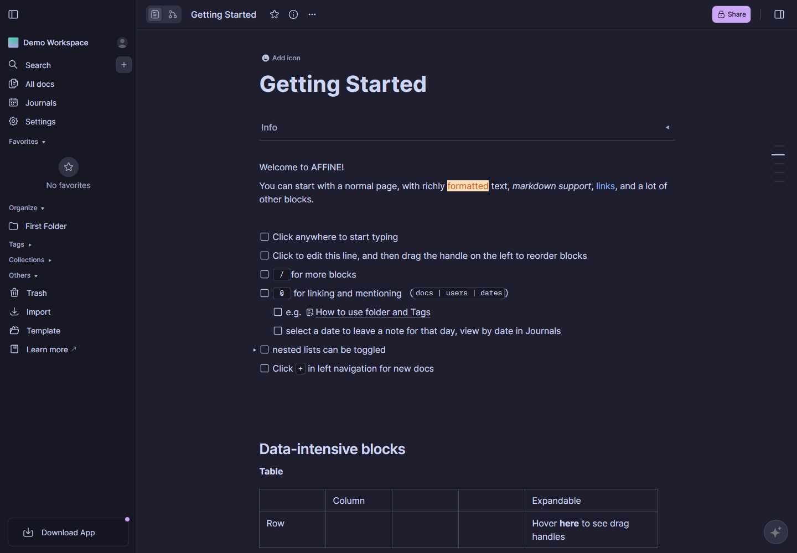
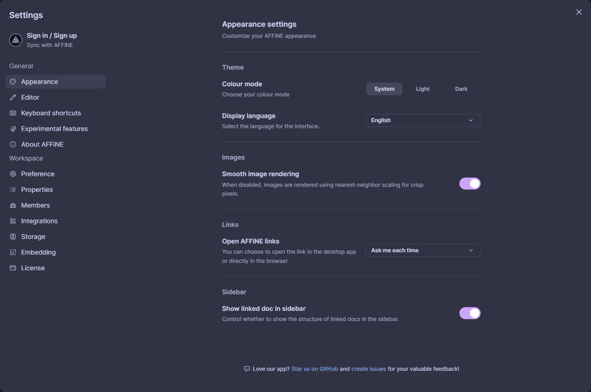

# AFFiNE Catppuccin Mocha

A Catppuccin Mocha color overlay for self-hosted AFFiNE. Mauve is the main accent.

This is an independent community theme. It is not an official AFFiNE or Catppuccin port.



<details>
<summary>Appearance settings preview</summary>



</details>

These previews show anonymous demo content. They are not a claim of native-app or mobile-device coverage.

## Compatibility lock

| Component | Reviewed target |
| --- | --- |
| AFFiNE | `0.27.4`, commit `b4c8548c09da21b2898443559a5b846f0ccf5dd8` |
| `@toeverything/theme` | `1.1.23`, design commit `8851de3927b48eeb23ae374360ca0f97b11cd93b` |
| Catppuccin palette | commit `07d02aa110ef9eb7e7427afca5c73ba9cf7f8ebd` |

The compatibility lock is not a promise of support for other releases.
`@toeverything/theme/v2` is a subpath of the locked package, not a separate version 2 package.

## Scope

- Mocha colors apply in both native Light and Dark appearances.
- The overlay does not change `data-theme`, saved preferences, or workspace content.
- Fonts, font sizes, layout dimensions, spacing, and component geometry stay upstream.
- Explicit text highlights, whiteboard palettes, notes, shapes, frames, callouts, tags, and calendar colors stay upstream.
- Content palettes still follow the native appearance or the independent whiteboard appearance.
  The CSS overlay does not make every whiteboard color follow Mocha.
- Explicit content colors and Shiki syntax colors stay upstream.
  Use native Dark appearance for dark-code reading. Native Light still uses the upstream `light-plus` syntax colors.
- Images, videos, canvas content, PDFs, and SVG artwork receive no global filters or paint overrides.
- Shared neutral tokens also change default document text, code backgrounds, and page or whiteboard backgrounds.
  This is **not** strict UI/content color isolation.
- The overlay runs only inside `@media screen and (forced-colors: none)`.
  Print and forced-colors modes receive no declarations from this overlay.
  Upstream print behavior still applies. The theme does not promise a white print background.

The only `!important` declaration is `color-scheme: dark !important`.
It overrides next-themes' inline native-control appearance hint.
It does not change the actual appearance setting or `data-theme`.
No color token or component paint rule uses `!important`.

## Install

See [installation, removal, and upgrades](docs/install.md).

The documented route is a **self-maintained reverse-proxy adaptation**, not an official CSS API.
It serves a local derived bundle for one exact host and one reviewed application CSS path.
It does not inject HTML or change application files in place.
The stable compatibility target has no audited server-side arbitrary-CSS setting.
Its experimental Theme Editor is not a supported stable installation path.

## Build and test

Use Python 3.12 or newer. No package installation is required.

```sh
python -X utf8 scripts/build.py
python -X utf8 scripts/build.py --check
python -X utf8 -m unittest discover -s tests -v
```

The build uses the checked-in palette and token-name lock. It does not contact upstream services.
The tests use only the Python standard library and local files.
They check:

- Byte-for-byte generation across processes and hash seeds.
- The official palette values and recorded source revision and hash.
- Exact upstream token names, duplicates, unresolved references, and variable cycles.
- The screen and forced-colors boundary, with one native `color-scheme` exception.
- No external resources, typography, geometry, global media effects, or content-palette overrides.
- At least 4.5:1 for the declared text, placeholder, semantic, and filled-button color pairs.
- Filled-button hover overlays and 0.9 control-opacity compositing, including both label and fill.
- Focus and active input indicators at the separate 3:1 non-text contrast threshold.
- Safe bundle creation and rejection of wrong inputs, existing outputs, repeated bundles, and unreviewed versions.

Contrast tests cover explicit token pairs, not every rendered component or user-created color combination.
They do not guarantee contrast for arbitrary authored highlights or syntax colors.
Disabled controls are not included in the text-contrast guarantee.
Secondary text tests cover Base, Mantle, Crust, Surface0, and the mapped input layers.
They do not treat Surface1 or Surface2 border colors as general secondary-text backgrounds.
The offline provenance test checks recorded metadata. It does not download or authenticate the original upstream file.

The workflow in `.github/workflows/test.yml` runs the checks on GitHub Actions.
Its presence is not evidence of a completed Actions run, deployment, or browser validation.

## Repository contents

- `affine-catppuccin-mocha.css`: generated standalone overlay.
- `scripts/build.py`: deterministic generator and explicit semantic mapping.
- `scripts/bundle.py`: local-only, append-only derived-bundle helper.
- `palette/`: extracted official Mocha values and their MIT notice.
- `compatibility/`: locked upstream token names and version identities.
- `tests/`: offline contract and bundle safety tests.
- `docs/install.md`: proxy installation and maintenance boundaries.

Do not publish original application CSS, derived bundles, deployment receipts, logs, account data, or private workspace screenshots.
The `.gitignore` allows only named public files. Review the index before each publication.
Ignore rules do not protect files that are already tracked or explicitly added with `git add -f`.

## Sources and license

- [Locked AFFiNE release](https://github.com/toeverything/AFFiNE/releases/tag/v0.27.4)
- [Locked theme source](https://github.com/toeverything/design/tree/8851de3927b48eeb23ae374360ca0f97b11cd93b/packages/theme/src)
- [Locked official palette](https://github.com/catppuccin/palette/blob/07d02aa110ef9eb7e7427afca5c73ba9cf7f8ebd/palette.json)
- [WCAG text-contrast calculation and scope](https://www.w3.org/WAI/WCAG22/Understanding/contrast-minimum.html)

MIT, copyright 2026 EiraWalker.
Palette: MIT, copyright 2021 Catppuccin.
See [LICENSE](LICENSE), [palette/LICENSE](palette/LICENSE), and [third-party notices](THIRD_PARTY_NOTICES.md).
